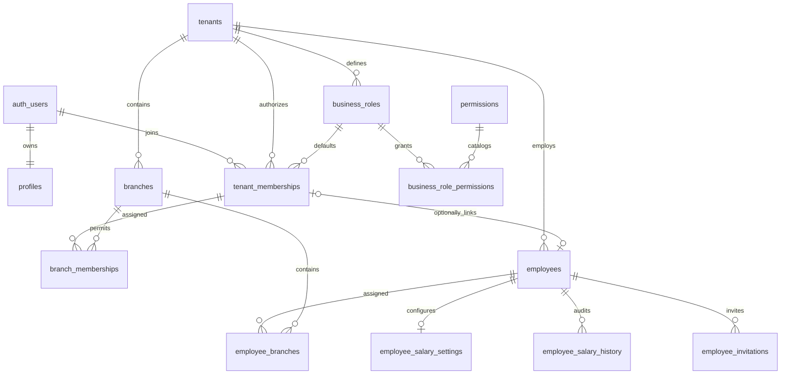

# Architecture and authorization

## Application and schema

A modular monolith: Next.js App Router, feature modules under `src/features`, shared Tailwind/shadcn primitives, local Supabase PostgreSQL/Auth/Storage. PGlite is tests only. No customer/payment/LMS/payroll module or Storage bucket exists.

Per-request SSR clients use cookies. The proxy refreshes sessions; protected layouts/actions verify `auth.getUser()`. Metadata and unverified session payloads never grant roles. User-specific pages are dynamic/request-scoped; no shared tenant cache/ISR.

Tenants contain identity/type/contact, UZS/Asia/Tashkent defaults, creation time, canonical owner. Profiles are self-only; the authorized tenant team RPC supplies member details without a global directory. Membership/branch role references are tenant-bound. Employees have nullable linked membership, optional case-insensitively tenant-unique email, and active/inactive/archived status. Composite references enforce tenant ownership.

## Ownership and upgrades

`create_business` derives Owner from `auth.uid()` and creates business, membership, first branch atomically. A trigger seeds tenant roles before membership creation. Deferred references/constraint triggers require an active canonical Owner; a partial unique index permits only one. Transfer, deletion, and suspension are unsupported.

Migration 004 backfills roles/membership role IDs while preserving existing assignments. It flushes deferred owner-trigger events before altering populated membership tables. Migration 005 adds checked RPCs and wraps the legacy membership entry point over the same engine. Original migrations remain unchanged. Ownerless/ambiguous legacy businesses stop upgrades with diagnostics, rather than silently assigning ownership or resetting data.

## Single permission engine

Existing `private.has_permission(tenant, permission, branch?)` now reads live tenant roles and branch overrides. Legacy enum/global `role_permissions` remain compatibility data, not independent authority. Legacy branch keys alias canonical view/manage. `tenant.read` requires enabled membership.

`private.member_enabled` requires active membership and no linked inactive/archived employee. Every permission check uses it, so existing sessions immediately lose access in that tenant after deactivation/archive; other businesses remain independent. Owner employment/access cannot be suspended.

`permission_grants` supplies global and per-branch grants to server context. Its union supports navigation only; actions check the actual requested scope. RLS and RPCs independently authorize the verified subject. Cookies, frontend IDs, branch choices, and metadata are never authorization evidence.

A branch override replaces its branch-scoped default. Business-wide grants remain business-wide. Inactive branches are hidden from read-only users; branch managers may restore authorized ones. Switchers list active authorized branches.

Employee HR records are shared across assignments. `private.employee_allowed` requires the operation globally or in **every assigned branch**; unassigned employees require global permission. Edits check old and new branches. Viewer in A plus Editor in B cannot edit an A+B employee; salary access in B alone cannot expose its shared compensation. No partial profile redaction is attempted.

## Roles and writes

Defaults: Owner, Admin, Branch Manager, Sales Manager, Cashier, Teacher, Employee, plus legacy Staff. System roles are immutable. Owner has all catalog grants; Admin broadly manages existing employees/salary/branches/roles but cannot invite/enroll new accounts. Manager has branch-scoped HR view/update and branch management. Future-module grants are inert until those modules exist.

`save_business_role` requires global `roles.manage`; custom scope is immutable. Known assignable grants must be a subset of the actor's permissions; branch roles cannot grant role management. No wildcard/platform permission exists.

`assign_member_role` locks the tenant, validates role/branch ownership and delegation, protects Owner, and restricts new enrollment to Owner. Linked employee branch changes require HR update access and synchronize HR/login assignments. Suspension keeps historical HR branches. `set_business_member` remains an Owner-only wrapper for legacy enrollment; existing edits use `/roles` to preserve overrides. Direct role/membership DML is revoked.

`save_employee` checks create/update, old/new branch coverage, archive/restore permissions, and Owner protection. It never accepts a login user ID. Linked assignment changes additionally require role management; retained overrides remain. `archive_employee` uses independent archive permission without granting arbitrary updates. No employee, salary history, Auth account, or membership deletion occurs.

## Salary confidentiality

Amounts: numeric(18,2); percentages: numeric(7,4), constrained 0–100. Per-type checks distinguish fixed monthly/hourly/per-lesson, percentage with basis, base plus bonus with basis, and none. All RPC decimal input/output and audit snapshots use strings, avoiding JavaScript precision loss. No payroll computation occurs.

Only checked `get_employee_salary`, `salary_history`, `save_employee_salary` RPCs serve compensation. Reads require salary view across the employee scope; saves additionally require manage, lock the employee, prohibit archived changes, and append old/new values/actor/time/reason atomically. History has no client mutation path. Salary/invitation tables have RLS but no client grants/policies, preventing direct and nested reads. Unauthorized server components never fetch/render compensation.

## Invitations

Canonical Owner generates a 64-hex token for an active unlinked employee with email and a non-Owner tenant role. Only SHA-256 hash is stored. Tokens expire in seven days, are single-use/revocable, and replacement revokes the pending link. Delivery is manual; no invitation email sender or service-role Auth user creation exists.

The public token route validates format, sets a one-hour HTTP-only SameSite=Lax cookie, and redirects without employee metadata; response is no-store/no-referrer. Login/registration/confirmation preserve the pending flow. Preview requires verified Auth with matching confirmed email, unchanged employee email/active status, and active canonical Owner issuer.

Acceptance locks tenant, employee, invitation in that order, revalidates facts, applies the common membership engine, links the original employee, and marks accepted atomically. It reuses Auth accounts across businesses and cannot replace ownership. Wrong account, revoked/expired/used token, inactive employee, or changed email fails. The pending flow can be dismissed or reopened after cookie expiry.

## Request and extension boundaries

HTTP-only business/branch cookies are revalidated preferences. Unauthorized selection redirects, and unavailable branch requires explicit reselection. Submitted tenant must match current verified workspace. Next actions retain origin checks; feedback omits credentials/internal SQL errors. Auth callback destinations use an explicit allowlist; local recovery uses PKCE and configured loopback origin. Public configuration rejects service-role credentials and remote local-development URLs. No hosted project is linked.

Future modules must require tenant IDs/composite tenant references, explicit grants, RLS, indexes, operation/branch permission checks, and cross-tenant tests in the same migration. Reuse this engine and per-request clients. Add private Storage policies with an actual upload feature. Never use UI visibility, JWT metadata roles, or shared caches as authority.

Portable tests execute real migration SQL with minimal Auth contracts, not GoTrue/PostgREST/SMTP/browser behavior. Complete native Docker-backed migration/tests/type generation and browser Auth/form/QA before another module. See [verification](verification.md) and [setup/walkthrough](../README.md).
