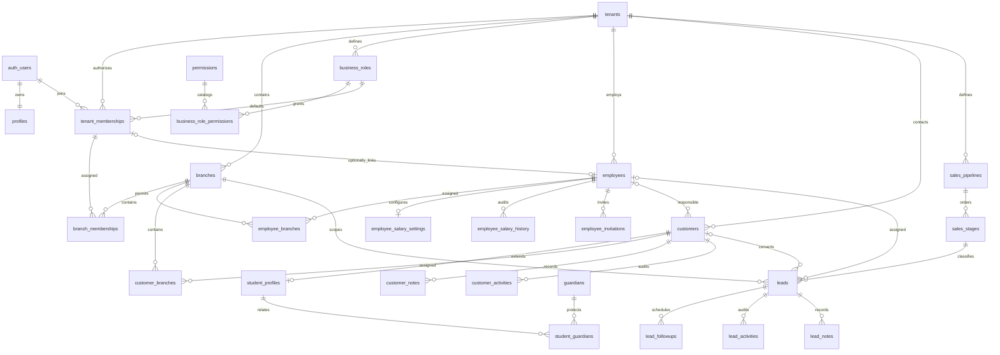

# Architecture and authorization

## Application and schema

A modular monolith: Next.js App Router, feature modules under `src/features`, shared Tailwind/shadcn primitives, local Supabase PostgreSQL/Auth/Storage. PGlite is tests only. Customers/students, Sales CRM and the cashbox/ledger foundation are implemented; invoices/payments, expenses/transfers/refunds, financial reports, LMS enrollment/progress, payroll calculation, external messaging, and Storage buckets remain outside this increment.

Per-request SSR clients use cookies. The proxy refreshes sessions; protected layouts/actions verify `auth.getUser()`. Metadata and unverified session payloads never grant roles. User-specific pages are dynamic/request-scoped; no shared tenant cache/ISR.

Tenants contain identity/type/contact, UZS/Asia/Tashkent defaults, creation time, canonical owner. Profiles are self-only; the authorized tenant team RPC supplies member details without a global directory. Membership/branch role references are tenant-bound. Employees have nullable linked membership, optional case-insensitively tenant-unique email, and active/inactive/archived status. Composite references enforce tenant ownership.

## Ownership and upgrades

`create_business` derives Owner from `auth.uid()` and creates business, membership, first branch atomically. A trigger seeds tenant roles before membership creation. Deferred references/constraint triggers require an active canonical Owner; a partial unique index permits only one. Transfer, deletion, and suspension are unsupported.

Migration 004 backfills roles/membership role IDs while preserving existing assignments. It flushes deferred owner-trigger events before altering populated membership tables. Migration 005 adds checked RPCs and wraps the legacy membership entry point over the same engine. Original migrations remain unchanged. Ownerless/ambiguous legacy businesses stop upgrades with diagnostics, rather than silently assigning ownership or resetting data.

## Single permission engine

Existing `private.has_permission(tenant, permission, branch?)` now reads live tenant roles and branch overrides. Legacy enum/global `role_permissions` remain compatibility data, not independent authority. Legacy branch keys alias canonical view/manage. `tenant.read` requires enabled membership.

`private.member_enabled` requires active membership and no linked inactive/archived employee. Every permission check uses it, so existing sessions immediately lose access in that tenant after deactivation/archive; other businesses remain independent. Owner employment/access cannot be suspended.

`permission_grants` supplies global and per-branch grants to server context. Its union supports navigation only; actions check the actual requested scope. RLS and RPCs independently authorize the verified subject. Cookies, frontend IDs, branch choices, and metadata are never authorization evidence.

A branch override replaces its branch-scoped default. Business-wide grants remain business-wide. Inactive branches are hidden from read-only users; branch managers may restore authorized ones. Switchers list active authorized branches.

Employee HR records are shared across assignments. `private.employee_allowed` requires the operation globally or in **every assigned branch**; unassigned employees require global permission. Edits check old and new branches. Viewer in A plus Editor in B cannot edit an A+B employee; salary access in B alone cannot expose its shared compensation. No partial profile redaction is attempted.

## Roles and writes

Defaults: Owner, Admin, Branch Manager, Sales Manager, Cashier, Teacher, Employee, plus legacy Staff. System roles are immutable. Owner has all catalog grants; Admin broadly manages existing employees/salary/branches/roles but cannot invite/enroll new accounts. Manager has branch-scoped HR view/update and branch management. Future-module grants are inert until those modules exist.

`save_business_role` requires global `roles.manage`; custom scope is immutable. Known assignable grants must be a subset of the actor's permissions; branch roles cannot grant role management. No wildcard/platform permission exists.

`assign_member_role` locks the tenant, validates role/branch ownership and delegation, protects Owner, and restricts new enrollment to Owner. Linked employee branch changes require HR update access and synchronize HR/login assignments. Suspension keeps historical HR branches. `set_business_member` remains an Owner-only wrapper for legacy enrollment; existing edits use `/roles` to preserve overrides. Direct role/membership DML is revoked.

`save_employee` checks create/update, old/new branch coverage, archive/restore permissions, and Owner protection. It never accepts a login user ID. Linked assignment changes additionally require role management; retained overrides remain. `archive_employee` uses independent archive permission without granting arbitrary updates. No employee, salary history, Auth account, or membership deletion occurs.

## Salary confidentiality

Amounts: numeric(18,2); percentages: numeric(7,4), constrained 0–100. Per-type checks distinguish fixed monthly/hourly/per-lesson, percentage with basis, base plus bonus with basis, and none. All RPC decimal input/output and audit snapshots use strings, avoiding JavaScript precision loss. No payroll computation occurs.

Only checked `get_employee_salary`, `salary_history`, `save_employee_salary` RPCs serve compensation. Reads require salary view across the employee scope; saves additionally require manage, lock the employee, prohibit archived changes, and append old/new values/actor/time/reason atomically. History has no client mutation path. Salary/invitation tables have RLS but no client grants/policies, preventing direct and nested reads. Unauthorized server components never fetch/render compensation.

## Invitations

Canonical Owner generates a 64-hex token for an active unlinked employee with email and a non-Owner tenant role. Only SHA-256 hash is stored. Tokens expire in seven days, are single-use/revocable, and replacement revokes the pending link. Delivery is manual; no invitation email sender or service-role Auth user creation exists.

The public token route validates format, sets a one-hour HTTP-only SameSite=Lax cookie, and redirects without employee metadata; response is no-store/no-referrer. Login/registration/confirmation preserve the pending flow. Preview requires verified Auth with matching confirmed email, unchanged employee email/active status, and active canonical Owner issuer.

Acceptance locks tenant, employee, invitation in that order, revalidates facts, applies the common membership engine, links the original employee, and marks accepted atomically. It reuses Auth accounts across businesses and cannot replace ownership. Wrong account, revoked/expired/used token, inactive employee, or changed email fails. The pending flow can be dismissed or reopened after cookie expiry.

## Request and extension boundaries

HTTP-only business/branch cookies are revalidated preferences. Unauthorized selection redirects, and unavailable branch requires explicit reselection. Submitted tenant must match current verified workspace. Next actions retain origin checks; feedback omits credentials/internal SQL errors. Auth callback destinations use an explicit allowlist; local recovery uses PKCE and configured loopback origin. Public configuration rejects service-role credentials and remote local-development URLs. No hosted project is linked.

Future modules must require tenant IDs/composite tenant references, explicit grants, RLS, indexes, operation/branch permission checks, and cross-tenant tests in the same migration. Reuse this engine and per-request clients. Add private Storage policies with an actual upload feature. Never use UI visibility, JWT metadata roles, or shared caches as authority.

Portable tests execute real migration SQL with minimal Auth contracts. Native Docker-backed migrations/tests and type generation now run locally; separate live tests cover GoTrue, PostgREST, authenticated rendering, and rendered server-form submission. Browser visual/mobile/client-interaction QA and recovery-link redemption remain manual. See [verification](verification.md) and [setup/walkthrough](../README.md).

## Customers, students, and personal information

`src/features/customers` owns actions, queries, and generated row types. Pages reuse shared forms/layout and the same per-request Auth/workspace context. Shared `allScopes` is now in workspace context and remains re-exported by employee queries for compatibility. Customer writes are checked transactional RPCs; reads use RLS or explicitly checked directory/duplicate/employee-choice RPCs. There is no second role mechanism.

One customer contact row is extended by an optional student row. Composite tenant-aware references bind branches, statuses, tags, responsible employees, fields, guardians and relationships. Contact email/phones are not unique; student identifiers are unique within a tenant. Birth dates cannot be future dates. Optional values are NULL when omitted. Archived contacts remain readable to authorized users and retain all related records; mutations require restoration first.

Customer branch access follows full coverage: global permission or permission in every assigned branch. The requested operation is independently checked for existing and new scope. Directory branch selection defaults to the verified workspace cookie but cannot widen authorization; explicit All authorized branches still passes database checks. Different branch roles cannot be unioned. A narrow employee-choice RPC returns active same-scope IDs/names to customer staff without exposing HR or compensation.

Notes require separate view/manage grants and original-author-only edits. Activity captures verified actor identity/name, UTC timestamps and before/after values. Notes-only audit events require note-view permission, so historical note content cannot leak through the generic timeline. Direct mutations of all customer and audit tables are revoked; no tenant role can erase protected history.

Guardians are one tenant contact reused via student relationships, with per-student relationship/emergency flags. Visibility derives from an authorized linked student, or business-wide customer access for unlinked contacts. Shared contact edits require all linked student scopes, and are audited in every affected student timeline. Unlink removes only the relationship, preserves the contact/history, and permits reuse by administrators.

Tenant catalog settings use global customer settings/tag grants. Catalog records can be deactivated without deleting references; the default status stays active. Custom field definitions have fixed supported type, with string-transport exact numbers/date/boolean/text validation and tenant-bound values. Duplicate suggestions are checked reads only; no automatic merging. Customer statuses are relationship states, separate from sales pipeline stages.

See the [Step 4 walkthrough](../README.md#customer--student-workflows-step-4) and [verification record](verification.md) for live SQL/HTTP coverage and remaining visual/browser checks. Sales leads now reference the shared customer at conversion, while course enrollment/progress remains a later LMS concern.

## Sales CRM boundary

Sales feature code lives under `src/features/sales` and `src/components/sales`; App Router pages compose the shared Auth/workspace/layout/forms. Existing customer activity presentation is generalized to accept a lead actor/kind/detail record; it is not backed by a duplicate role engine. There was no reusable general task table, so lead follow-ups have a tenant/lead-specific table with composite references. Customer/student data is reused at conversion instead of copied into a second customer system.

A lead has exactly one branch. `private.lead_allowed` requires current `leads.view` and the requested operation in that actual branch through existing `private.has_permission`. Pipeline/source configuration requires global permission. Directory/follow-up queries and analytics explicitly filter the current subject inside security-definer functions; direct SELECT uses matching RLS. Assignee eligibility examines the prospective employee's existing live membership/branch role permissions, not a job title or user-supplied role. Client role flags are presentation only.

The public sales tables are read-only to clients. Checked RPCs own creation/edit, stage/outcome transitions, archive, append-only notes, follow-up writes, settings/reorder, and conversion. `lead_activities` supplies stage and assignment histories as structured append-only events rather than duplicating history tables. `sales_configuration_history` captures catalog before/after values and reorder sequences. Stage/source/loss references are tenant-bound and historical references survive deactivation; delete is not exposed.

Stage changes lock the lead, compare the expected previous stage and reject stale updates. Open/lost/disqualified transitions map stage outcomes to matching lead status; entering Converted must use conversion. Reopening requires stage and update authority. Outcome constraints require full conversion/loss metadata as a group. Moving branches checks both scopes and pending task eligibility. Completed follow-ups preserve actor/time/outcome, and completion is idempotent.

Conversion uses the established tenant→record lock order, then invokes checked customer creation or verifies an existing visible customer with the lead branch. Existing contact data and branches are never silently overwritten. Visible duplicate matches require explicit acknowledgement for a separate new contact. Customer creation, lead link/status/stage/timestamp and both audit events commit atomically. Repeats/concurrent calls return the stored link; rollback tests inject a failure after customer creation to verify no partial result. Converted leads remain traceable and cannot be edited into another contact; customer/student changes remain in their own module. No student enrollment or lesson is created.

Time input is interpreted in the business IANA timezone, validated, converted to ISO UTC, and passed to PostgreSQL with an offset. DB timestamps are timestamptz. Direct follow-up RPC input without an offset is rejected. Reports use business-local creation-date boundaries, non-archived records and per-row analytics+view permission. Converted/current-outcome counts and overdue tasks refer to the same creation cohort; the rate does not mix conversion dates and creation dates.

Kanban is a bounded view (20 cards per stage) with exact aggregate column counts and table pagination for the rest. Native drag/drop and keyboard/touch Move controls call the same checked action, optimistically change cards/counts, and restore the prior state on errors. A shadcn Sheet collects loss reasons; converted-stage drops direct users to transactional conversion. React receives only serialized card/catalog data, never a server Supabase client or workspace object. Native confirmation dialogs and an explicit checkbox protect sensitive conversion/archive UX; authorization remains server/database enforced.

Remaining verification is browser pointer/keyboard/mobile/focus/rollback visuals and recovery-link redemption. Local SQL, actual Auth/API and rendered HTTP form submission are independently tested. See [sales walkthrough](../README.md#sales-crm-step-5) and [verification](verification.md). Future course/group enrollment should reference customers/students separately from sales stages, with its own scoped permissions and transaction tests.

## Financial foundation boundary

Step 6A adds `src/features/finance`, `src/components/finance`, and protected `/finance/cashboxes` pages without changing customer or sales workflows. Three additive migrations introduce a reviewed UZS currency catalog, immutable transaction envelopes and signed ledger movements, cashbox metadata, audit history and matching RLS. Money is bounded exact PostgreSQL NUMERIC, returned as decimal strings. The current balance is a SQL sum, never an editable field. Cashbox-row locks serialize postings and configuration/status changes; tenant-wide request keys plus payload checks and advisory locks make retry handling safe. Deferred constraints require complete current-kind postings and forbid appending extra movements to an existing envelope.

`cashboxes.view/manage` are reused, `cashboxes.adjust` and `finance.audit.view` extend the same role engine, and assigned-branch grants cannot authorize business-wide cashboxes. Client direct money reads/mutations are denied; narrow checked RPCs return exact text and enforce current employee/membership status. Opening/adjustment workflows are available now. Future financial source records, allocations, same-currency transfer legs and linked reversals must extend this envelope contract with their own invariants and tests in 6B–6E. They are not implemented or reported as working in 6A. See [finance design and manual verification](finance.md).
